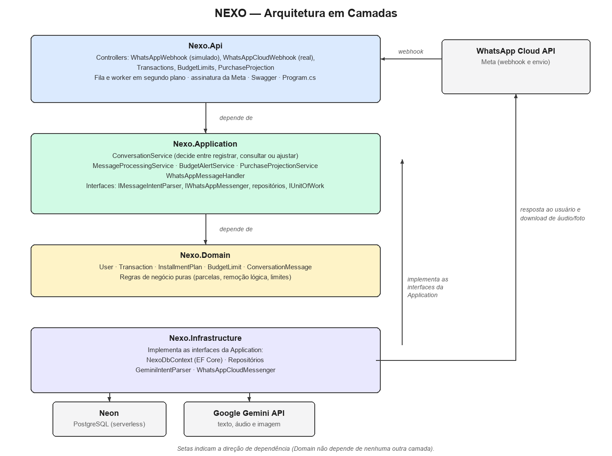

# NEXO

Assistente financeiro que funciona dentro do WhatsApp. Você escreve, fala ou manda a foto de uma nota fiscal, e o NEXO registra o gasto, responde perguntas e ajuda a planejar.

<p>
  
  &nbsp;
  
</p>

## O que dá para fazer

| Para | Mensagem de exemplo |
|---|---|
| Registrar um gasto ou receita | `gastei 30 no mercado` |
| Registrar uma compra parcelada | `comprei um notebook de 3000 em 10 parcelas` |
| Consultar os gastos | `quanto gastei com mercado esse mês?` e depois `e no mês passado?` |
| Definir um limite | `limite de 500 para lazer` |
| Saber se dá para comprar | `consigo comprar uma moto de 18000?` |
| Ver o resumo e os gráficos | `resumo do mês`, `gráfico por categoria` |
| Cadastrar uma conta fixa | `netflix 55,90 todo dia 10` |
| Criar uma meta | `quero juntar 3000 até junho` |
| Corrigir um erro | `apaga o último`, `corrige para 25` |

Também aceita **áudio** e **foto de nota fiscal**. A palavra `menu` mostra as opções.

## Como foi construído

- **Etapa 1** (Projetos em Computação I): API, banco de dados, registro em linguagem natural e compras parceladas.
- **Etapa 2** (Projetos em Computação II): WhatsApp de verdade, áudio e foto, conversa com contexto, limites, projeção de compra, gráficos, metas e contas fixas.

**Tecnologias:** .NET 10, PostgreSQL (Neon) com Entity Framework Core, Google Gemini, WhatsApp Cloud API e SkiaSharp.

A IA entende a mensagem e redige respostas. Quem calcula os valores é o código.



Mais detalhes:
- [Modelo de dados](docs/diagrams/er-diagram.png)
- [Caminho de uma mensagem](docs/diagrams/sequence-diagram.png)
- [Comparação dos modelos de IA](docs/avaliacao-modelos.md)

## Como rodar

Você precisa do .NET 10 SDK, de um banco PostgreSQL e de uma chave do [Gemini](https://aistudio.google.com).

```bash
dotnet user-secrets set "ConnectionStrings:Default" "<connection string>" --project src/Nexo.Api
dotnet user-secrets set "Gemini:ApiKey" "<chave>" --project src/Nexo.Api
dotnet ef database update --project src/Nexo.Infrastructure --startup-project src/Nexo.Api
dotnet run --project src/Nexo.Api --launch-profile https
```

O Swagger abre em https://localhost:7117/index.html e permite testar sem o WhatsApp.

Para os testes automatizados: `dotnet test tests/Nexo.Tests`.

### Com o WhatsApp

Cadastre também os dados do app da Meta:

```bash
dotnet user-secrets set "WhatsApp:AccessToken" "<token>" --project src/Nexo.Api
dotnet user-secrets set "WhatsApp:PhoneNumberId" "<phone number id>" --project src/Nexo.Api
dotnet user-secrets set "WhatsApp:VerifyToken" "<texto à sua escolha>" --project src/Nexo.Api
dotnet user-secrets set "WhatsApp:AppSecret" "<app secret>" --project src/Nexo.Api
```

O script `scripts/iniciar-demo.ps1` sobe a API, abre um túnel e atualiza o endereço na Meta. O passo a passo para outra máquina está em [docs/rodar-no-notebook.md](docs/rodar-no-notebook.md).

## Próximos passos

Alertas enviados sem o usuário perguntar, leitura de extrato em PDF e hospedagem com endereço fixo.

---

Trabalho de Conclusão de Curso em Ciência da Computação, UNESP Rio Claro, 2026.
**Autor:** André Augusto Costa Dionísio. **Orientador:** Prof. Denis Henrique Pinheiro Salvadeo (DEMAC).
